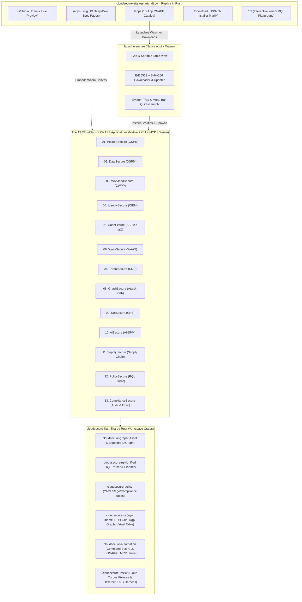

# CloudSecure: Master Architectural Blueprint & Governance Plan

> **Authored by**: `agency-master-plan-architect`, `agency-software-architect`, `agency-cloud-security-architect`  
> **Target Executor**: Gemini 3.8 Flash (via `agency-agents-orchestrator`)  
> **Guardrail**: Zero Code Execution during Planning Phase. Immutable Markdown Engineering Contract.

---

## 1. Conceptual Masterclass: Philosophy, First Principles & Landscape

### 1.1 The Core Problem & Opportunity
Enterprise Cloud-Native Application Protection Platforms (CNAPPs), exemplified by **Enterprise Multi-Cloud CNAPP (covering CSPM, DSPM, CWPP, CIEM, ASPM, WAAS, CDR, Attack Path, CNS, AI-SPM, Supply Chain, Policy-as-Code, and Executive Compliance)**, consolidate over a dozen critical cloud security disciplines: CSPM, DSPM, CWPP, CIEM, ASPM/IaC Security, WAAS, CDR, Attack Path Graph analysis, Cloud Network Security (CNS), AI-SPM, Supply Chain Security, RQL Policy authoring, and Executive Compliance reporting. However, traditional CNAPP tooling suffers from three structural bottlenecks:
1. **Opaque SaaS Lock-in & Telemetry Latency**: Security engineers cannot run deterministic, offline, local-first posture, IAM graph, and data classification engines on their own workstations or air-gapped CI runners without shipping sensitive cloud state to a multi-tenant SaaS.
2. **Runtime Bloat**: Existing desktop and CLI security tools split across slow Python scripts (IaC Scanner), heavy JVM/Node.js wrappers, or 250MB Electron dashboards that consume gigabytes of RAM.
3. **Lack of Unified Agent & Human Ergonomics**: Security tools are either CLI-only (lacking visual attack-path, layer, and data-lineage inspection) or web-only (impossible to script deterministically via stdio, JSON-RPC, or Model Context Protocol).

**How `getartcraft.com` (`storytold`) Solved This for Creative Software**:
ArtCraft (`getartcraft.com` / `getartcraft.com/apps`) demonstrated a paradigm shift: take an entire monolithic enterprise suite (13 creative and office applications), and rebuild **every single module from scratch in 100% pure Rust** using:
- **`egui` + `eframe` + `wgpu`** for native GPU-accelerated desktop interfaces (macOS, Windows, Linux, FreeBSD) AND in-browser **WebAssembly (`trunk`)** from a single codebase, with **zero Electron, zero Tauri, and zero OS webview wrappers**.
- **A Unified Native Launcher (`craft-launcher`)** that discovers, installs, verifies SHA-256 checksums, updates, and opens all 13 applications from a single grid/table window or system tray menu.
- **A 4-Way Deterministic Command Architecture ("Built for Agents")**: Every user action is a serializable Rust `Command` enum/struct executed against a pure domain engine, allowing the exact same engine to be driven by:
  1. The interactive `egui` desktop/Wasm GUI
  2. A headless high-speed CLI (`<app>-cli`)
  3. A JSON-RPC stdio/socket automation channel
  4. A built-in **Model Context Protocol (MCP)** server with offscreen `wgpu`/`egui_kittest` screenshot rendering.

### 1.2 Theoretical Foundations Applied to CloudSecure
1. **Clean-Room Hexagonal Architecture (Ports & Adapters)**:
   - Every CloudSecure application separates its **Pure Domain Engine** (`crates/<app>-core`, zero I/O, zero UI dependencies, 100% deterministic state transitions) from **Adapters** (`crates/cloudsecure-ui` for `egui`, `crates/cloudsecure-cli` for clap CLI, `crates/cloudsecure-mcp` for JSON-RPC/MCP, and `crates/cloudsecure-connectors` for AWS/Azure/GCP/Kubernetes/OCI/local filesystem ingestion).
2. **Unified Resource Query Language (`cloudsecure-rql`)**:
   - Just as enterprise CNAPPs unify posture, network, audit event, IAM, and data queries under **RQL**, CloudSecure implements a shared, zero-copy Rust parser (`winnow`) and query planner (`petgraph` + columnar predicate pushdown) supporting all 5 RQL families:
     - `config from cloud.resource where ...`
     - `network from vpc.flow_record where ...`
     - `event from cloud.audit_logs where ...`
     - `iam from cloud.entitlements where ...`
     - `data from cloud.data_store where ...`
3. **Unified Security Graph (`cloudsecure-graph`)**:
   - All 13 apps read and write a canonical, content-addressed **Security Asset & Exposure Graph** (`petgraph::stable_graph::StableDiGraph<AssetNode, RelationEdge>`) persisted locally in SQLite (WAL mode) or exported as deterministic `.csec` snapshot bundles (zstd-compressed canonical JSON/Parquet).

### 1.3 Comparative Precedents
- **ArtCraft (`storytold/craft-launcher` & `storytold/photocraft`)**: Workspace layout (`resolver = "3"`, `edition = "2024"`, `unsafe_code = "forbid"`), deflated font embedding (`egui_fonts.rs`) to pass strict Wasm binary size gates, `xtask` packaging, and offscreen PNG rendering via control channel.
- **SQLite & Git**: Content-addressed snapshots, single-file portable state (`.csec`), and deterministic replay of every command.
- **Trivy / Falco / OpenPolicyAgent**: Proven static analysis and policy evaluation semantics, re-engineered into memory-safe, multithreaded (`rayon`) Rust crates with zero runtime interpreter overhead.

---

## 2. Surgical Critique & Red Teaming (What Could Break?)

Following `agency-master-plan-architect`'s Anti-Fantasy Standard, we surface **10 concrete failure vectors** and bake non-negotiable mitigations into the architecture before a single line of Rust is written:

| # | Failure Vector | Why It Happens | Mandatory Architectural Mitigation |
|---|---|---|---|
| **FV-01** | **Wasm Target Compilation Failure from Native OS Crates** | Cloud SDKs (`aws-config`), raw sockets, `rusqlite` C-bindings, or OS keychain crates fail to compile on `wasm32-unknown-unknown`. | Strict Cargo target gating (`[target.'cfg(not(target_arch = "wasm32"))'.dependencies]`). Core engines (`*-core`, `cloudsecure-rql`, `cloudsecure-graph`, `cloudsecure-policy`) are 100% pure Rust with zero OS syscalls. Wasm builds use in-memory/IndexedDB storage and fixture/HTTP ingestion. |
| **FV-02** | **JS-to-Wasm Boundary Chatter Killing Frame Rate** | Passing thousands of cloud resource nodes or log events one-by-one across `wasm-bindgen` stalls browser rendering. | Because the UI itself (`egui`) compiles inside the Wasm module and renders directly to WebGPU/WebGL2 canvas, the UI-to-Engine boundary stays 100% inside Wasm linear memory. External file imports cross the boundary once as a single `&[u8]` buffer. |
| **FV-03** | **Wasm Binary Bloat (> 5MB) Blocking First Paint** | Embedding uncompressed fonts, debug symbols, or bloated regex tables makes web apps unusable on slow connections. | Enforce `opt-level = "z"`, `lto = true`, `codegen-units = 1`, `panic = "abort"`, `strip = true`, `wasm-opt -Oz`, and `flate2`-compressed font assets (`egui_fonts.rs`), capping `.wasm` bundles under `900 KB` gzipped. |
| **FV-04** | **Accidental Mutation of Live Cloud Infrastructure** | A CSPM/CIEM remediation playbook executed blindly could lock out production IAM roles or delete security groups. | **Governance by Design**: Cloud connectors default to **Read-Only Assessment Mode**. Remediation generators output signed, reviewable Terraform/CLI diff artifacts (`.patch` / `.tf`) and require explicit human two-step confirmation before any optional apply command can run. |
| **FV-05** | **Credential Leakage in Snapshots, Logs, or MCP Output** | DSPM or CodeSecure scanning real repos/buckets could write discovered secrets or PII into plaintext logs or MCP responses. | Mandatory `SecretRedactor` wrapper (`zeroize` crate on drop + deterministic SHA-256 token masking `csec_redacted_<8hex>`) applied at the ingestion boundary before any finding enters `cloudsecure-graph`, logs, or UI tables. |
| **FV-06** | **UI Thread Starvation During Large Repo or Bucket Scans** | Running 500 IaC rules or DSPM regex/entropy scans on the `egui` render thread freezes the window at 0 FPS. | All scan engines execute on background worker pools (`rayon` on native, Web Worker / chunked frame scheduler on Wasm) and communicate progress via lock-free bounded `crossbeam_channel` / `std::sync::mpsc` streams polled per `egui` frame. |
| **FV-07** | **Stranded Fleet from a Broken Self-Updater** | If `launchersecure` replaces a running binary or installs a corrupted archive, the user's installation breaks permanently. | Every release publishes a signed `manifest.json` with SHA-256 digests and Ed25519 signatures. Downloads stream to a staging `.part` file, verify hash + signature before extraction, check process locks so running apps are never overwritten, and preserve `N-1` backup for 1-click rollback. |
| **FV-08** | **13-App Code Duplication & Maintenance Drift** | Building 13 separate apps without shared UI shell, theme, table, graph, and MCP crates causes massive code duplication and inconsistent UX. | 80% of infrastructure lives in shared workspace crates (`cloudsecure-ui`, `cloudsecure-rql`, `cloudsecure-graph`, `cloudsecure-policy`, `cloudsecure-automation`, `cloudsecure-testkit`). Each of the 13 apps is a focused domain crate + workbench configuration (`1,500-3,000 LOC` each). |
| **FV-09** | **Catastrophic Backtracking (ReDoS) in DSPM & Secret Scanners** | Naive PCRE/backtracking regexes hang indefinitely on adversarial minified JS or binary blobs. | Exclusively use Rust's `regex` / `aho-corasick` crates, which guarantee linear-time $O(n)$ finite-automaton execution with zero backtracking, plus a strict per-file scan byte budget (`16 MB` default). |
| **FV-10** | **Generic AI Slop in Web Portal & App Dashboards** | Defaulting to purple gradients, fake stats, non-functional buttons, or 4-card filler dashboards destroys credibility with security engineers. | Strict enforcement of `DESIGN.md` and the `antislop` Delivery Gate + `agency-ui-finish-gate-reviewer` HOLD/PASS gate on every single task. |

### 2.1 Anti-Scope-Creep Filter (Forbidden in Iteration 1)
- **NO Electron, NO Tauri, NO React/Next.js Node.js runtime**: Both the desktop apps (`egui`/`eframe`) and the web portal (`cloudsecure-site` via Rust `axum` + static HTML/CSS/Wasm generator) are 100% Rust.
- **NO Kernel Modules (`.ko` / `.sys`) Required for Installation**: `WorkloadSecure` (CWPP) and `NetSecure` (CNS) support Linux eBPF/procfs telemetry when privileges are granted, and fall back cleanly to agentless container image, Kubernetes manifest, and VPC flow log analysis on unprivileged macOS/Windows/Wasm environments.
- **NO Paid SaaS Auth / Stripe Billing**: CloudSecure is 100% free and open-source (`MIT OR Apache-2.0`).

---

## 3. Implementation Plan Blueprint (Repository Topology & State Contracts)

### 3.1 System Architecture Diagram

### 3.2 Complete Workspace & File Mutation Manifest

All code resides in a unified Cargo workspace at the repository root (with `cargo xtask split-repos` capable of syncing individual app mirrors to `github.com/cloudsecure/<app>` just like `storytold/*`):

- `[NEW]` `Cargo.toml`: Workspace root (`resolver = "3"`, `edition = "2024"`, `license = "MIT OR Apache-2.0"`, `unsafe_code = "forbid"`).
- `[NEW]` `rust-toolchain.toml`: Pins stable Rust toolchain + `wasm32-unknown-unknown` target + `clippy` + `rustfmt`.
- `[NEW]` `DESIGN.md`: Visual direction, WCAG AA tokens, and `antislop` Purpose-Gate ledger.
- `[NEW]` `README.md`: Suite overview, architecture table, build instructions, and 13-app directory.
- `[NEW]` `LICENSE-MIT` & `LICENSE-APACHE`: Dual open-source licensing.
- `[NEW]` `xtask/Cargo.toml` & `xtask/src/main.rs`: Pure Rust build, Wasm bundler, offscreen screenshot generator, SHA-256 release manifest signer, and GitHub org/repo automation tool.
- **Shared Crates (`crates/*`)**:
  - `[NEW]` `crates/cloudsecure-types/`: Canonical domain types (`CloudProvider`, `AssetId`, `ResourceRecord`, `Severity`, `ComplianceFramework`, `Finding`, `RemediationPatch`, `RedactedSecret`).
  - `[NEW]` `crates/cloudsecure-graph/`: `petgraph`-backed Cloud Security Graph, blast-radius traversal, shortest attack-path Dijkstra/BFS solver, and `.csec` snapshot serializer.
  - `[NEW]` `crates/cloudsecure-rql/`: Complete RQL lexer, recursive-descent/combinator parser (`winnow`), AST, type-checker, and execution engine for `config`, `network`, `event`, `iam`, and `data` queries.
  - `[NEW]` `crates/cloudsecure-policy/`: Built-in library of 150+ real security policies mapped to CIS, NIST 800-53, SOC 2, PCI-DSS v4, HIPAA, and OWASP, plus custom YAML rule evaluator.
  - `[NEW]` `crates/cloudsecure-connectors/`: Read-only cloud snapshot loaders (AWS Config/CloudTrail/IAM/S3 JSON, Azure Resource Graph, GCP Asset Inventory, Kubernetes YAML/live API, Terraform HCL/plan JSON, OCI tarballs) + deterministic synthetic multi-cloud corpus generator.
  - `[NEW]` `crates/cloudsecure-ui/`: Shared `egui` + `eframe` + `wgpu` studio framework (`SecureTheme` Light/Dark/System, HUD top bar, `1px` bordered panels, virtualized 100k-row data table, interactive 2D/3D `wgpu` node-graph viewport, diff viewer, command palette `Cmd+K`, deflated font loader `egui_fonts.rs`, 10-locale i18n catalog).
  - `[NEW]` `crates/cloudsecure-automation/`: Deterministic `AppCommand` trait, undo/redo history ledger, headless CLI runner, JSON-RPC 2.0 stdio server, and Model Context Protocol (MCP) server (`tools/list`, `tools/call`, `resources/list`).
  - `[NEW]` `crates/cloudsecure-testkit/`: Multi-cloud benchmark fixtures, property-testing generators (`proptest`), and `egui_kittest` offscreen PNG visual assertion harness.
- **Suite Launcher (`apps/launchersecure`)**:
  - `[NEW]` `apps/launchersecure/`: Native `egui` + WebAssembly launcher with Grid/Table views, platform asset resolver, SHA-256 + Ed25519 verifier, self-updater, and system tray integration.
- **The 13 CloudSecure Rust Applications (`apps/*`)**:
  - `[NEW]` `apps/posturesecure/` + `apps/posturesecure-cli/` (01. CSPM)
  - `[NEW]` `apps/datasecure/` + `apps/datasecure-cli/` (02. DSPM)
  - `[NEW]` `apps/workloadsecure/` + `apps/workloadsecure-cli/` (03. CWPP)
  - `[NEW]` `apps/identitysecure/` + `apps/identitysecure-cli/` (04. CIEM)
  - `[NEW]` `apps/codesecure/` + `apps/codesecure-cli/` (05. ASPM / IaC)
  - `[NEW]` `apps/waassecure/` + `apps/waassecure-cli/` (06. WAAS)
  - `[NEW]` `apps/threatsecure/` + `apps/threatsecure-cli/` (07. CDR)
  - `[NEW]` `apps/graphsecure/` + `apps/graphsecure-cli/` (08. Attack Path Graph)
  - `[NEW]` `apps/netsecure/` + `apps/netsecure-cli/` (09. Cloud Network Security)
  - `[NEW]` `apps/aisecure/` + `apps/aisecure-cli/` (10. AI-SPM)
  - `[NEW]` `apps/supplysecure/` + `apps/supplysecure-cli/` (11. Supply Chain Security)
  - `[NEW]` `apps/policysecure/` + `apps/policysecure-cli/` (12. RQL & Policy Studio)
  - `[NEW]` `apps/compliancesecure/` + `apps/compliancesecure-cli/` (13. Executive Command & Audit Exporter)
- **Web Portal (`web/cloudsecure-site`)**:
  - `[NEW]` `web/cloudsecure-site/`: Rust (`axum` + static HTML/CSS/Wasm generator) web application replicating `getartcraft.com`, `getartcraft.com/apps`, `/apps/:slug`, `/download`, `/rql`, `/docs`, `/security`, `/privacy`, `/terms`, plus Playwright QA suite (`qa-playwright-capture.sh`).
- **CI/CD & Governance (`.github/workflows/*`)**:
  - `[NEW]` `.github/workflows/ci.yml`: Format, Clippy (`-D warnings`), unit/property tests, Wasm size gate, Playwright visual QA.
  - `[NEW]` `.github/workflows/release.yml`: Cross-platform matrix build (macOS universal `.dmg`, Windows `.msi` + `.zip`, Linux `.deb`/`.rpm`/`.AppImage`, FreeBSD, Wasm), SHA-256 manifest generation, and staged release publishing.

---

## 4. Validation Protocol & Ground Truth Verification

1. **Compiler & Lint Gate**:
   - `cargo fmt --all -- --check`
   - `cargo clippy --workspace --all-targets -- -D warnings` (with `unsafe_code = "forbid"` in root `Cargo.toml`)
2. **Unit, Property & Corpus Tests**:
   - `cargo test --workspace`
   - `proptest` fuzzing on `cloudsecure-rql` parser (10,000 generated RQL strings must never panic) and `cloudsecure-connectors` parsers.
3. **Offscreen GUI & Screenshot Evidence (`egui_kittest` + `EvidenceQA`)**:
   - `cargo xtask render-screenshots` drives each of the 14 `egui` apps (Launcher + 13 CNAPP apps) through its JSON control channel in both Light and Dark themes across Empty, Loading, Populated, and Error states, saving deterministic PNGs to `docs/screenshots/`.
4. **Web Portal E2E & Accessibility Verification**:
   - `./qa-playwright-capture.sh http://127.0.0.1:8080 public/qa-screenshots` captures Desktop (`1920x1080`), Tablet (`768x1024`), and Mobile (`375x667`) screenshots in both Light (`#F2F1EE`) and Dark (`#0B0B0C`) themes, tests every interactive control (R-35), verifies zero horizontal scroll (R-03), and runs `contrast-check.py` against all CSS tokens (R-25).

---

## 5. Rollback Strategy & Failure Containment

1. **Launcher Staged Rollout & Instant Manifest Rollback**:
   - Updates roll out via static signed `releases/channel/{stable,beta}/manifest.json` (1% -> 10% -> 100%).
   - Reverting a broken release requires a single atomic commit restoring the previous `manifest.json` (< 30 seconds). `launchersecure` retains the previous binary in `<app_data>/rollback/<app>-prev` for instant offline downgrade.
2. **Circuit Breakers in Cloud Connectors**:
   - Any cloud API rate-limit (`HTTP 429` / `ThrottlingException`) triggers exponential backoff with jitter and falls back to cached local `.csec` state without crashing the UI or corrupting the SQLite WAL database.
